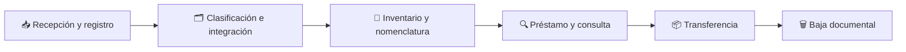

### Organizo la información para que se pueda encontrar, entender y usar.

Archivista, egresada de la **Licenciatura en Administración de Archivo y Gestión Documental** (UNAM). Me interesa cómo la tecnología (automatización, ML y NLP) puede mejorar la forma en que se gestionan los documentos.

---

## 👋 Hola, soy Mariana

Trabajo con archivos desde antes de titularme: empecé en el sector público y hoy cuido el archivo jurídico de una empresa constructora. Lo que más disfruto es convertir un archivo desordenado en uno donde todo se encuentra rápido, con reglas claras que cualquiera pueda seguir.

- 🔭 Desarrollando el manual e instructivos de archivo de Grupo HYCSA
- 🤖 Explorando la clasificación automática de documentos con ML y NLP (mi tesis)
- 🎨 Me gusta que lo técnico también se vea bien: diseño fichas, formatos y documentos claros de leer
- 📬 Abierta a conversar sobre proyectos de archivo, gestión documental y automatización

---

## 📂 Proyectos destacados

### 📑 01 · Resumen ejecutivo de contratos

Página web en PHP que convierte los datos de cada contrato en una **ficha clara y lista para imprimir**, para que quien consulte encuentre lo importante de un vistazo.

| | |
|---|---|
| **Problema** | La información clave de los contratos estaba dispersa y era difícil de revisar rápido. |
| **Qué hice** | Diseñé el formato: carta vertical con cuatro fichas por hoja, pensado para imprimirse o guardarse como PDF. |
| **Detalles que resolví** | El folio de cada contrato se interpreta para mostrar la **obra** (código y nombre) en la ficha, se leen obras con letras en su clave, y cada contrato puede mostrarse en **USD o MXN**. |
| **Diseño** | Cuidé la jerarquía visual y la tipografía para que la hoja se lea bien aun con mucha información. |
| **Herramientas** | PHP · HTML y CSS · diseño para impresión |

<!-- Para completar: agrega aquí una captura de una hoja con DATOS FICTICIOS, por ejemplo:  -->

### 🗄️ 02 · Manual e instructivos de archivo

Manual de procedimientos para organizar el archivo de una empresa, con instructivos paso a paso, pensado para implementarse en **todas las oficinas del grupo**.

| | |
|---|---|
| **Problema** | Cada oficina manejaba su archivo a su manera; hacía falta un criterio común. |
| **Qué hice** | Construí el manual sobre una base ya existente para obra, y lo extendí al **ciclo completo del archivo** (trámite, concentración e histórico) y a los procesos de **préstamo y consulta**. |
| **Instructivos** | Préstamo y consulta de expedientes · Clasificación e integración de expedientes · Transferencia y baja documental, todos con el mismo formato del manual. |
| **Base normativa** | Trabajé sobre el instructivo de elaboración de documentos y registros, que sirve de base al resto. |
| **Herramientas** | Gestión documental · redacción técnica y normativa · diseño de formatos |

<!-- Para completar: agrega aquí una imagen de una página del manual SIN información interna, o un diagrama propio. -->

### 🤖 03 · Clasificación automática de documentos (tesis)

Mi tema de tesis: usar **machine learning y procesamiento de lenguaje natural (NLP)** para que un sistema identifique de forma automática el **tipo documental**, la **serie** o el **nivel de confidencialidad** de un documento.

| | |
|---|---|
| **Pregunta** | ¿Puede la tecnología ayudar a clasificar documentos con el mismo criterio que usaría un archivista? |
| **Enfoque** | Combinar los principios de clasificación archivística con técnicas de ML y NLP. |
| **Herramientas** | Machine learning · NLP · cuadro de clasificación archivística |

<!-- Para completar: estado de la tesis (en desarrollo, en revisión...), herramientas que usarás (por ejemplo Python) y, cuando haya, resultados o un repositorio. -->

---

## 🧭 Cómo organizo un archivo

Esta es la ruta que sigo, y la que quedó plasmada en mis instructivos:

Un documento pasa por tres etapas: **archivo de trámite** (mientras se usa a diario), **de concentración** (cuando ya se consulta poco) e **histórico** (cuando tiene valor permanente). Cada etapa necesita sus propias reglas, y por eso el manual las cubre todas.

## 🛠️ En qué puedo ayudar

| Necesidad | Lo que hago |
|---|---|
| Un archivo desordenado | Clasificación, integración y nomenclatura de expedientes; inventarios |
| No hay reglas claras | Manuales e instructivos con el mismo formato, fáciles de seguir |
| Papeles que ya no se usan | Procedimientos de transferencia y baja documental |
| Control y seguimiento | Bases de datos, reportes mensuales y control de préstamos |
| Cumplimiento | Instrumentos archivísticos y Programa Anual de Desarrollo Archivístico, con base en la Ley General de Archivos |
| Documentos físicos frágiles | Estabilización, restauración menor, escaneo y control de calidad |
| Información difícil de leer | Fichas y formatos con diseño claro, listos para imprimir |

## 🧰 Habilidades y herramientas

**Archivo**

**Herramientas**

**Idiomas:** Español (nativo) · Inglés (básico)

---

## 💼 Experiencia

**Archivo Jurídico** · Grupo HYCSA · *Dic. 2025 – Actual*
- Custodia y control de documentación jurídica y contratos de obra.
- Organización de expedientes conforme a su nomenclatura, para facilitar su identificación y localización.
- Elaboración del manual de archivo del grupo y de sus instructivos (ver proyecto 02).

**Encargada de Archivo** · Dependencia del gobierno de la Ciudad de México · *Jun. 2023 – Dic. 2025*
- Registro, localización y control de expedientes, y gestión de su base de datos.
- Elaboración de reportes mensuales para el control de la información recibida y resguardada.
- Elaboración del Programa Anual de Desarrollo Archivístico.
- Creación, actualización y manejo de instrumentos archivísticos.
- Seguimiento de procedimientos de baja documental.

## 🏛️ Prácticas profesionales

<b>Archivo Histórico de la Ciudad de México</b>

 

- Creación de base de datos, expedientes e inventarios.
- Estabilización de material archivístico.
- Intervenciones menores de restauración de planos.
- Escaneo de documentos.
- Mejora estética de documentos con programas de edición, para mayor legibilidad y mejor acceso.

<b>Fideicomiso de Fomento Minero</b>

 

- Creación de identificadores de cajas, portadas y etiquetas para expedientes.
- Cosido de expedientes.
- Captura de pólizas diarias, viáticos y regionales.
- Llenado de inventario general.
- Transferencia primaria de expedientes.

## 🎓 Formación

- **Licenciatura en Administración de Archivo y Gestión Documental** (egresada) · UNAM, Facultad de Filosofía y Letras · 2019 – 2023
- **Técnica profesional en Archivística** · UNAM, Facultad de Filosofía y Letras

## 📚 Cursos, seminarios y diplomados

<b>Ver los 9 cursos</b>

 

**Instituto Nacional de Transparencia, Acceso a la Información y Protección de Datos Personales (INAI)**
- Seminario *"Utilidad Social de los Archivos: Reflexiones y Perspectivas para la Gestión Documental"* · 2025
- *Normas técnicas para fortalecer la implementación y cumplimiento de la Ley General de Archivos* · 2024
- *Inteligencia Artificial y los Archivos en México: análisis de política pública, regulación y buenas prácticas* · 2024
- *Ética Pública* · 2024

**Asociación Latinoamericana de Archivos (ALA)**
- *Menos es más: simplificación administrativa y Gestión Documental* · 2025
- *Valorar Documental en el siglo XXI: el modelo taxonómico a la valoración funcional* · 2025

**Comisión Nacional para la Protección y Defensa de los Usuarios de Servicios Financieros (CONDUSEF)**
- Diplomado en Educación Financiera · 2025

**Archivo Histórico de la Ciudad de México (IMAC)**
- Programa especializado: *Creatividad, diseño e innovación: Técnicas y herramientas* · 2021
- Curso de digitalización y calibración de escáner para la mejora de calidad · 2021

---

## 📬 Hablemos

¿Tienes un archivo que ordenar, un manual que redactar o una idea de automatización documental? Escríbeme.

