### Organizo la información para que se pueda encontrar, entender y usar.

Archivista con licenciatura en **Administración de Archivo y Gestión Documental** (UNAM). Me interesa cómo la tecnología (automatización, ML y NLP) puede mejorar la forma en que se gestionan los documentos.

---

## 💼 Experiencia

**Encargada de Archivo** · Dependencia del gobierno de la Ciudad de México · *Jun. 2023 – Actual*
- Registro, búsqueda y control de expedientes y de la base de datos del archivo.
- Elaboración del Programa Anual de Desarrollo Archivístico.
- Creación y actualización de instrumentos archivísticos.
- Reportes mensuales de la información recibida y resguardada.
- Procedimientos y seguimiento de bajas documentales.

**Prácticas profesionales**
- **Archivo Histórico de la Ciudad de México:** bases de datos, expedientes e inventarios, estabilización de material, escaneo y mejora de legibilidad con programas de edición.
- **Fideicomiso de Fomento Minero:** identificadores y etiquetas de cajas, cosido de expedientes, inventario general y transferencia primaria.

## 🎓 Formación

- **Licenciatura en Administración de Archivo y Gestión Documental** · UNAM, Facultad de Filosofía y Letras · 2019 – 2023
- **Técnica profesional en Archivística** · UNAM, Facultad de Filosofía y Letras

## 📂 Proyectos

| Proyecto | Descripción |
|---|---|
| 🤖 **Clasificación automática de documentos** | Tesis sobre el uso de *machine learning* y NLP para clasificar documentos de forma automática. |
| 📑 **Resumen ejecutivo de contratos** | Página web que presenta la información clave de cada contrato en fichas claras y fáciles de consultar. |
| 🗄️ **Manual de archivo** | Manual de procedimientos para organizar y conservar el archivo de una organización. |

## 📚 Cursos y seminarios

- **INAI** · *Inteligencia Artificial y los Archivos en México* (2024) · *Normas técnicas de la Ley General de Archivos* (2024) · *Utilidad social de los archivos* (2025) · *Ética pública* (2024)
- **ALA** · *Valorar documental en el siglo XXI* (2025) · *Menos es más: simplificación administrativa y gestión documental* (2025)
- **CONDUSEF** · Diplomado en Educación Financiera (2025)
- **Archivo Histórico de la CDMX** · Digitalización y calibración de escáner (2021)

## 🧰 Herramientas

**Archivo:** administración de expedientes · inventarios · instrumentos archivísticos · digitalización y control de calidad · bajas documentales

**Idiomas:** Español (nativo) · Inglés (básico)

## 📬 Contacto

