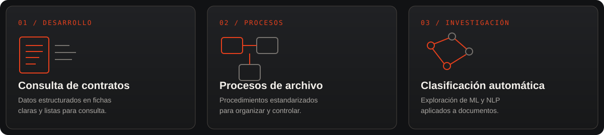

# Mariana Guzmán

### Gestión documental · Tecnología · Diseño de soluciones digitales

**Conecto la gestión documental con la tecnología para transformar información en soluciones útiles.**

Soy egresada de la Licenciatura en Administración de Archivo y Gestión Documental de la UNAM. Mi trabajo se encuentra en la intersección entre los archivos, los sistemas de información, el diseño y la automatización de procesos.

Me interesa desarrollar herramientas que permitan organizar, consultar, interpretar y aprovechar mejor la información.

[Proyectos](#proyectos) · [Áreas de trabajo](#áreas-de-trabajo) · [Trayectoria](#trayectoria) · [Contacto](#contacto)

---

## Proyectos

Soluciones, documentación técnica e investigación en torno a la gestión y el aprovechamiento de la información.

### 01 / Consulta y visualización de información contractual

**Transformar datos dispersos en información estructurada y accesible.**

Desarrollo de una herramienta web en PHP para convertir información de contratos en fichas ejecutivas, facilitando su identificación, revisión y consulta.

**Soluciones implementadas**
- Generación de fichas ejecutivas listas para impresión.
- Distribución de cuatro fichas por hoja tamaño carta.
- Interpretación de folios para identificar obras y sus claves.
- Compatibilidad con claves alfanuméricas.
- Visualización de importes en distintas monedas (MXN y USD).

**Tecnologías:** PHP · HTML · CSS

**Disciplinas:** Gestión de información · Desarrollo web · Diseño de información documental.

> Próxima evidencia: captura de la interfaz y ejemplo de ficha con información ficticia.

---

### 02 / Estandarización de procesos de archivo

**Diseño de procedimientos para una gestión documental organizada y reproducible.**

Desarrollo de un manual de archivo e instructivos operativos para establecer criterios comunes de organización, control y consulta documental en distintas oficinas.

**Componentes**
- Clasificación e integración de expedientes.
- Inventarios y nomenclatura documental.
- Préstamo y consulta de expedientes.
- Transferencia y baja documental.
- Estandarización de procedimientos y formatos.

**Disciplinas:** Archivística · Gestión de procesos · Documentación técnica · Diseño de información.

> Próxima evidencia: muestra de un instructivo y diagrama de procesos sin información interna.

---

### 03 / Clasificación automática de documentos

**Exploración de inteligencia artificial aplicada a la gestión documental.**

Proyecto de investigación enfocado en el uso de aprendizaje automático (*Machine Learning*) y procesamiento de lenguaje natural (*NLP*) para explorar la clasificación automatizada de documentos.

**Líneas de investigación**
- Identificación de tipos documentales.
- Reconocimiento de series documentales.
- Clasificación por niveles de confidencialidad.
- Aplicación de principios archivísticos en modelos computacionales.

**Tecnologías y conceptos:** Machine Learning · NLP · Clasificación archivística.

**Naturaleza:** Proyecto de investigación / Tesis.

> Próxima evidencia: esquema conceptual, metodología y resultados cuando estén disponibles.

---

## Áreas de trabajo

### Gestión documental y archivística
- Organización y clasificación de archivos.
- Diseño de instrumentos archivísticos.
- Inventarios y control de expedientes.
- Transferencias y bajas documentales.
- Digitalización y control de calidad.
- Elaboración de manuales y procedimientos.

### Tecnología y sistemas de información
- Desarrollo de herramientas web con PHP.
- Organización y estructuración de datos.
- Diseño de sistemas de consulta.
- Automatización de procesos documentales.
- Exploración de inteligencia artificial aplicada a archivos.

### Diseño y comunicación de información
- Diseño de fichas y formatos documentales.
- Jerarquización y visualización de información.
- Diseño editorial y documentación técnica.
- Elaboración de materiales claros y funcionales.

---

## Tecnologías y herramientas

| Área | Herramientas y conocimientos |
|---|---|
| Desarrollo web | PHP · HTML · CSS |
| Productividad y datos | Microsoft Office · Excel |
| Diseño | Photoshop · GIMP |
| Investigación | Machine Learning · NLP |
| Gestión documental | Instrumentos archivísticos · Inventarios · Procedimientos |

---

## Trayectoria

**Grupo HYCSA** · Archivo Jurídico  
*Diciembre 2025 – Actualidad*

- Custodia y control de documentación jurídica y contratos de obra.
- Organización de expedientes y normalización de nomenclaturas.
- Desarrollo de herramientas para facilitar la consulta de información contractual.
- Elaboración del manual de archivo y sus instructivos.

**Gobierno de la Ciudad de México** · Encargada de Archivo  
*Junio 2023 – Diciembre 2025*

- Registro, localización y control de expedientes.
- Administración de bases de datos documentales.
- Elaboración de reportes mensuales.
- Desarrollo y actualización de instrumentos archivísticos.
- Elaboración del Programa Anual de Desarrollo Archivístico.
- Seguimiento de procedimientos de baja documental.

---

## Formación

**Licenciatura en Administración de Archivo y Gestión Documental**  
Universidad Nacional Autónoma de México · Facultad de Filosofía y Letras · 2019–2023

**Técnica profesional en Archivística**  
Universidad Nacional Autónoma de México · Facultad de Filosofía y Letras

### Formación complementaria seleccionada
- Diplomado en Educación Financiera · CONDUSEF · 2025.
- Seminarios sobre gestión documental y archivos · Asociación Latinoamericana de Archivos · 2025.
- Seminario sobre inteligencia artificial y archivos · INAI · 2024.
- Normas técnicas para fortalecer la implementación de la Ley General de Archivos · INAI · 2024.
- Digitalización y calibración de escáner · Archivo Histórico de la Ciudad de México · 2021.

---

## Mi enfoque

La gestión documental no termina cuando un documento se organiza y se resguarda. También implica encontrar mejores formas de acceder a la información, comprenderla, relacionarla y aprovecharla.

Por eso me interesa explorar las posibilidades que ofrecen el desarrollo de software, la automatización y la inteligencia artificial para resolver problemas reales de los archivos y las organizaciones.

---

## Contacto

Estoy abierta a proyectos relacionados con gestión documental, desarrollo de herramientas de información, automatización y transformación digital.

