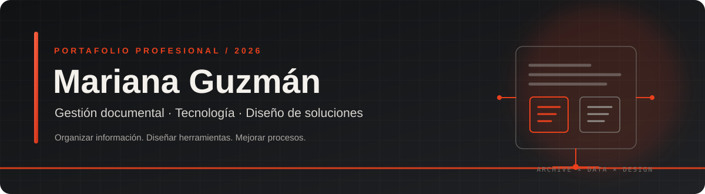

### Organizo la información para que se pueda encontrar, entender y usar.

Archivista, egresada de la **Licenciatura en Administración de Archivo y Gestión Documental** (UNAM). Me interesa cómo la tecnología (automatización, ML y NLP) puede mejorar la forma en que se gestionan los documentos.

---

## 👋 Hola, soy Mariana

- 🔭 Desarrollando el manual e instructivos de archivo de Grupo HYCSA
- 🤖 Explorando la clasificación automática de documentos con ML y NLP (mi tesis)
- 🗂️ Archivo jurídico y gestión documental, en el sector público y el privado

## 🧰 Habilidades y herramientas

**Archivo**

**Herramientas**

**Idiomas:** Español (nativo) · Inglés (básico)

---

## 💼 Experiencia

**Archivo Jurídico** · Grupo HYCSA · *Dic. 2025 – Actual*
- Custodia y control de documentación jurídica y contratos de obra.
- Organización de expedientes conforme a su nomenclatura, para facilitar su identificación y localización.
- Elaboración del manual de archivo del grupo: ciclo completo (trámite, concentración e histórico), préstamo y consulta.
- Desarrollo de instructivos de préstamo y consulta, clasificación e integración de expedientes, y transferencia y baja documental.

**Encargada de Archivo** · Dependencia del gobierno de la Ciudad de México · *Jun. 2023 – Dic. 2025*
- Registro, localización y control de expedientes.
- Gestión y actualización de la base de datos documental.
- Elaboración de reportes mensuales para el control de la información recibida y resguardada.
- Elaboración del Programa Anual de Desarrollo Archivístico.
- Creación, actualización y manejo de instrumentos archivísticos.
- Seguimiento de procedimientos de baja documental.

## 📂 Proyectos

| Proyecto | Descripción |
|---|---|
| 🤖 **Clasificación automática de documentos** | Tesis sobre el uso de *machine learning* y NLP para clasificar documentos de forma automática. |
| 📑 **Resumen ejecutivo de contratos** | Página web en PHP que presenta la información clave de cada contrato en fichas claras y fáciles de consultar, listas para imprimir o guardar como PDF. |
| 🗄️ **Manual e instructivos de archivo** | Manual de procedimientos para organizar y conservar el archivo de una organización, con instructivos de préstamo y consulta, clasificación e integración de expedientes, y transferencia y baja documental. |

## 🏛️ Prácticas profesionales

<b>Archivo Histórico de la Ciudad de México</b>

 

- Creación de base de datos, expedientes e inventarios.
- Estabilización de material archivístico.
- Intervenciones menores de restauración de planos.
- Escaneo de documentos.
- Mejora estética de documentos con programas de edición, para mayor legibilidad y mejor acceso.

<b>Fideicomiso de Fomento Minero</b>

 

- Creación de identificadores de cajas, portadas y etiquetas para expedientes.
- Cosido de expedientes.
- Captura de pólizas diarias, viáticos y regionales.
- Llenado de inventario general.
- Transferencia primaria de expedientes.

## 🎓 Formación

- **Licenciatura en Administración de Archivo y Gestión Documental** (egresada) · UNAM, Facultad de Filosofía y Letras · 2019 – 2023
- **Técnica profesional en Archivística** · UNAM, Facultad de Filosofía y Letras

## 📚 Cursos, seminarios y diplomados

<b>Ver los 9 cursos</b>

 

**Instituto Nacional de Transparencia, Acceso a la Información y Protección de Datos Personales (INAI)**
- Seminario *"Utilidad Social de los Archivos: Reflexiones y Perspectivas para la Gestión Documental"* · 2025
- *Normas técnicas para fortalecer la implementación y cumplimiento de la Ley General de Archivos* · 2024
- *Inteligencia Artificial y los Archivos en México: análisis de política pública, regulación y buenas prácticas* · 2024
- *Ética Pública* · 2024

**Asociación Latinoamericana de Archivos (ALA)**
- *Menos es más: simplificación administrativa y Gestión Documental* · 2025
- *Valorar Documental en el siglo XXI: el modelo taxonómico a la valoración funcional* · 2025

**Comisión Nacional para la Protección y Defensa de los Usuarios de Servicios Financieros (CONDUSEF)**
- Diplomado en Educación Financiera · 2025

**Archivo Histórico de la Ciudad de México (IMAC)**
- Programa especializado: *Creatividad, diseño e innovación: Técnicas y herramientas* · 2021
- Curso de digitalización y calibración de escáner para la mejora de calidad · 2021

## 📬 Contacto

