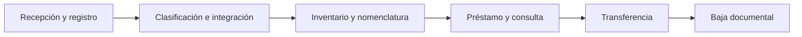

### Organizo la información para que se pueda encontrar, entender y usar.

Archivista, egresada de la **Licenciatura en Administración de Archivo y Gestión Documental** (UNAM). Me interesa cómo la tecnología (automatización, ML y NLP) puede mejorar la forma en que se gestionan los documentos.

---

# Mariana Guzmán

## Convierto archivos desordenados en sistemas que cualquiera puede encontrar y usar rápido

Soy archivista, egresada de la Licenciatura en Administración de Archivo y Gestión Documental de la Universidad Nacional Autónoma de México (UNAM). Trabajo con archivos desde antes de titularme: empecé en el sector público y hoy cuido el archivo jurídico de una empresa constructora.

Me interesa cómo la tecnología — automatización, aprendizaje automático (machine learning, ML) y procesamiento de lenguaje natural (natural language processing, NLP) — puede mejorar la forma en que se gestionan los documentos. También cuido que lo técnico se vea bien: diseño fichas, formatos y documentos claros de leer.

¿Tienes un archivo que ordenar, un manual que redactar o una idea de automatización documental?

- [GitHub: ggzman](https://github.com/ggzman)
- [Correo: Escríbeme](mailto:marianaghernandez1@gmail.com)

---

## Proyectos destacados

### 01 · Resumen ejecutivo de contratos

**Resultado:** la información clave de cada contrato ya se revisa de un vistazo, en una ficha lista para imprimir o guardar como PDF.

> Imagen pendiente: captura de una hoja de ejemplo con datos ficticios, para mostrar la ficha terminada.

**El problema.** La información clave de los contratos estaba dispersa y era difícil de revisar rápido.

**Lo que hice.** Diseñé una página web en PHP que convierte los datos de cada contrato en una ficha clara. El formato es carta vertical, con cuatro fichas por hoja, pensado para imprimirse o guardarse como PDF, con jerarquía visual y tipografía cuidadas para que la hoja se lea bien aun con mucha información.

**Detalles que resolví.** El folio de cada contrato se interpreta para mostrar la obra — código y nombre — en la ficha. El sistema lee también obras con letras en su clave, y cada contrato puede mostrarse en dólares estadounidenses (USD) o en pesos mexicanos (MXN).

**Herramientas:** PHP, HTML y CSS, diseño para impresión.

### 02 · Manual e instructivos de archivo — Grupo HYCSA

**Resultado:** un mismo criterio para organizar el archivo en todas las oficinas del grupo.

> Imagen pendiente: una página del manual sin información interna, o un diagrama del flujo de trabajo.

**El problema.** Cada oficina manejaba su archivo a su manera y hacía falta un criterio común.

**Lo que hice.** Construí el manual sobre una base ya existente para obra y lo extendí al ciclo completo del archivo — trámite, concentración e histórico — y a los procesos de préstamo y consulta. El trabajo se apoyó en el instructivo de elaboración de documentos y registros, que sirve de base al resto.

**Los instructivos.** Préstamo y consulta de expedientes; clasificación e integración de expedientes; transferencia y baja documental. Todos con el mismo formato del manual, paso a paso.

**Herramientas:** gestión documental, redacción técnica y normativa, diseño de formatos.

### 03 · Clasificación automática de documentos — tesis

**Resultado:** un proyecto de tesis en curso que explora si un sistema puede clasificar con el mismo criterio que usaría un archivista.

> Imagen pendiente: diagrama del enfoque o, cuando exista, una captura del clasificador.

**La pregunta.** ¿Puede la tecnología ayudar a clasificar documentos con el mismo criterio que usaría un archivista?

**El enfoque.** Combinar los principios de clasificación archivística con técnicas de ML y NLP para que un sistema identifique de forma automática el tipo documental, la serie o el nivel de confidencialidad de un documento.

**Herramientas:** machine learning, NLP, cuadro de clasificación archivística.

---

## Cómo organizo un archivo

Sigo una ruta única, la misma que quedó plasmada en mis instructivos:

Un documento pasa por tres etapas: archivo de trámite, mientras se usa a diario; archivo de concentración, cuando ya se consulta poco; y archivo histórico, cuando tiene valor permanente. Cada etapa necesita sus propias reglas, y por eso el manual las cubre todas.

## En qué puedo ayudar

**Un archivo desordenado.** Clasificación, integración y nomenclatura de expedientes, e inventarios.

**Reglas que no están claras.** Manuales e instructivos con el mismo formato, fáciles de seguir.

**Papeles que ya no se usan.** Procedimientos de transferencia y baja documental.

**Control y seguimiento.** Bases de datos, reportes mensuales y control de préstamos.

**Cumplimiento.** Instrumentos archivísticos y Programa Anual de Desarrollo Archivístico, con base en la Ley General de Archivos.

**Documentos físicos frágiles.** Estabilización, restauración menor, escaneo y control de calidad.

**Información difícil de leer.** Fichas y formatos con diseño claro, listos para imprimir.

---

## Sobre mí

**Experiencia.** Archivo Jurídico en Grupo HYCSA, desde diciembre de 2025, a cargo de la custodia de documentación jurídica y contratos de obra y de la elaboración del manual de archivo del grupo. Antes, Encargada de Archivo en una dependencia del gobierno de la Ciudad de México, de junio de 2023 a diciembre de 2025, con registro y control de expedientes, instrumentos archivísticos, Programa Anual de Desarrollo Archivístico y procedimientos de baja documental.

**Prácticas profesionales.** Archivo Histórico de la Ciudad de México: bases de datos, inventarios, estabilización de material, restauración menor de planos y escaneo. Fideicomiso de Fomento Minero: identificadores y etiquetas para expedientes, captura, inventario general y transferencia primaria.

**Formación.** Licenciatura en Administración de Archivo y Gestión Documental (egresada), UNAM, Facultad de Filosofía y Letras, 2019–2023. Técnica profesional en Archivística, UNAM, Facultad de Filosofía y Letras.

**Formación continua.** Nueve cursos, seminarios y un diplomado con el Instituto Nacional de Transparencia, Acceso a la Información y Protección de Datos Personales (INAI), la Asociación Latinoamericana de Archivos (ALA), la Comisión Nacional para la Protección y Defensa de los Usuarios de Servicios Financieros (CONDUSEF) y el Archivo Histórico de la Ciudad de México, en temas como Ley General de Archivos, inteligencia artificial y archivos, valoración documental, simplificación administrativa, educación financiera, diseño y digitalización.

**Habilidades clave.** Instrumentos archivísticos · Control de expedientes e inventarios · Manuales e instructivos · Transferencia y baja documental · Ley General de Archivos · Diseño de fichas y formatos claros para imprimir

**Idiomas:** español (nativo) · inglés (básico)

## Hablemos

¿Tienes un archivo que ordenar, un manual que redactar o una idea de automatización documental? Escríbeme.

- [GitHub: ggzman](https://github.com/ggzman)
- [Correo: Escríbeme](mailto:marianaghernandez1@gmail.com)

